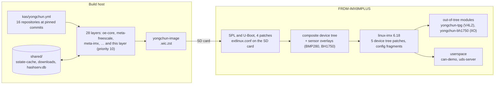

# meta-imx8mp-yongchun

A Yocto BSP layer for the NXP **FRDM-IMX8MPLUS**, built from scratch rather
than copied from a reference board — and a written record of why each decision
went the way it did.

The layer is headless and deliberately minimal. It defines its own distro,
machine and image on top of NXP's BSP, and carries local changes to the kernel
and bootloader as a patch series against the vendor trees.

| | |
|---|---|
| Board | FRDM-IMX8MPLUS (i.MX 8M Plus, 4 GB LPDDR4) |
| BSP | NXP LF6.18.20_2.0.0, Yocto 6.0 "wrynose" |
| Machine | `yongchun`, derived from `imx8mp-lpddr4-frdm` |
| Distro | `yongchun`, based on `fsl-imx-xwayland-minimal`, display stack removed |
| Image | `yongchun-image` — 268 MB, 1519 packages (week 5) |
| Boot | 3.2 s from the SPL banner to `Starting kernel`; 10.2 s from kernel start to the serial login (week 8, debug kernel config; [docs/02](docs/02-productization.md)) |
| Build | One `kas build` from a fresh clone: 490 min with nothing shared, 13 min when rebuilt from shared state (week 10; [ADR-0009](docs/adr/0009-kas-instead-of-repo.md), [ADR-0010](docs/adr/0010-shared-state-across-build-trees.md)) |

`yongchun` is the machine codename, after the Yongchun district in Taipei.

## Why this exists

I spent ten years in embedded firmware — C, ARM Cortex-M, FreeRTOS, and most
recently AUTOSAR Classic Platform complex device drivers on NXP S32K3 under
ISO 26262 and ASPICE. My Linux experience was application-layer. This project
is where I move down the stack into BSP work, and where the automotive domain
knowledge I already have meets a Linux platform.

The layer is therefore not a minimal "hello world" BSP. It deliberately
includes the parts that only show up in real products: update mechanisms,
read-only rootfs, boot-time measurement, licence hygiene, and a diagnostic
stack.

## Architecture



The build side is [ADR-0009](docs/adr/0009-kas-instead-of-repo.md) and
[ADR-0010](docs/adr/0010-shared-state-across-build-trees.md); the boot side is
[ADR-0006](docs/adr/0006-boot-device-tree-selection.md) to
[ADR-0008](docs/adr/0008-uboot-boot-path.md).

## Roadmap

Built over a twelve-week plan. Nothing is claimed before it is built.

| Weeks | Scope | Status |
|---|---|---|
| 1–3 | Yocto fundamentals on a Raspberry Pi 4B | ✅ |
| 4 | Vendor BSP baseline on FRDM-IMX8MPLUS, boot flow | ✅ |
| 5 | Custom layer, machine, distro; U-Boot and kernel | ✅ |
| 6 | Device tree: I2C sensor, pinctrl/IOMUX, GPIO LED, overlays | ✅ |
| 7 | Out-of-tree V4L2 capture driver (virtual test-pattern generator on vb2), packaged as a module recipe and autoloaded at boot; BMP280 pressure sensor through the mainline IIO driver, described in device tree | ✅ |
| 8 | Sensor device-tree overlays applied at boot through `extlinux.conf` `FDTOVERLAYS` (ADR-0007), with an out-of-tree IIO driver for a BH1750 light sensor added as a second overlay; SocketCAN on FlexCAN: vcan, internal loopback, then a physical bus with a CANable adapter; boot-time optimisation: U-Boot reaches the kernel 5.9 s sooner (ADR-0008) | ✅ |
| 9 | Done: a UDS diagnostic server over ISO-TP on SocketCAN — session control (0x10), read and write by identifier (0x22, 0x2E), security access (0x27) — checked from the host with udsoncan over vcan, and on the board over vcan and the FlexCAN–CANable bus. Not done: the AUTOSAR Classic vs Linux communication stack comparison and the IMX219 camera bring-up, both moved to the backlog | ⬜ |
| 10 | One-command build with kas: all 16 repositories pinned, and a from-scratch build from a fresh clone reproduces the image ([ADR-0009](docs/adr/0009-kas-instead-of-repo.md)); shared state, downloads and the hash equivalence database shared between build trees ([ADR-0010](docs/adr/0010-shared-state-across-build-trees.md)); this README | ✅ |
| 11 | Two weeks: OTA updates with A/B partitions, read-only rootfs with overlayfs, secure-boot concepts; CI on pull requests (`yocto-check-layer`, and a parse on a clean runner); unit tests and coverage for the UDS server; the AUTOSAR Classic vs Linux communication stack comparison | ⬜ |
| 12 | Final packaging: README, architecture diagram, demo GIF; a long-form technical write-up | ⬜ |

Weeks 1–3 happened on a Raspberry Pi 4B and live in a separate private
scratch repository; only the notes from that phase land here, under `docs/`.

## Quick start

The build environment is described in `kas/`
([ADR-0009](docs/adr/0009-kas-instead-of-repo.md)). kas clones the other 16
repositories at pinned commits and writes the build configuration. Run it from
an empty directory outside this repository: kas works in the current
directory.

```bash
git clone https://github.com/AsdreamChan/meta-imx8mp-yongchun.git
cp meta-imx8mp-yongchun/kas/local.yml.example meta-imx8mp-yongchun/kas/local.yml

mkdir kas-work && cd kas-work
L=../meta-imx8mp-yongchun
kas build $L/kas/yongchun.yml:$L/kas/accept-fsl-eula.yml:$L/kas/local.yml
```

The image is `build/tmp/deploy/images/yongchun/yongchun-image-yongchun.rootfs.wic.zst`,
with a `.wic.bmap` next to it.

- **`kas/accept-fsl-eula.yml` accepts NXP's EULA.** Read `meta-freescale/EULA`
  before adding it to the command line; the default configuration does not
  accept it.
- **`kas/dev.yml` is for a board on the bench.** It lets root log in without a
  password, on the console and over SSH; without it root is locked and no one
  can log in. Put `$L/kas/dev.yml` before `local.yml` on the command line. The
  tests below need it; an image that leaves the bench should not have it.
- **`kas/local.yml` belongs to one host** and git ignores it. The example sets
  `BB_NUMBER_THREADS` and `PARALLEL_MAKE` to 6. Both default to `nproc` and
  they multiply — on a sixteen-core machine that is up to 256 concurrent
  compiler processes, which is enough to exhaust 31 GB of RAM while
  `rust-native`, `clang-native`, `qtbase`, `boost` and `gcc` compile together.
- **A first build is long.** On the author's machine (WSL2, 16 threads, 25 GB
  RAM and 32 GB swap, kas 5.5) it took 490 minutes including downloads, and
  left 120 GB in `build/tmp`, 7.8 GB in `sstate-cache` and 12 GB in
  `downloads`.
- **To share state between build trees**, point every tree at one directory
  ([ADR-0010](docs/adr/0010-shared-state-across-build-trees.md)). The hash
  equivalence database has to move with the shared state:

  ```yaml
  local_conf_header:
    local-shared: |
      DL_DIR = "/path/to/shared/downloads"
      SSTATE_DIR = "/path/to/shared/sstate-cache"
      BB_HASHSERVE_DB_DIR = "${SSTATE_DIR}"
  ```

Until week 9 the layer was added to NXP's `repo`-based setup by hand;
ADR-0009 records why that changed.

## Tests

`tests/` checks the board while it runs. Over SSH: the Sprint 7 driver
unloads, loads with both devices bound, and loads again by modalias after a
reboot. On the serial console: a reboot goes through extlinux.conf, U-Boot
loads the BMP280 overlay, and the sensor is there once Linux is up
([ADR-0007](docs/adr/0007-sensor-overlays-at-boot.md)).

It needs [uv](https://docs.astral.sh/uv/) and an image built with
`kas/dev.yml`, so that root logs in over SSH with neither a password nor a
key. The console test also needs the board's debug USB on the host (under
WSL2, attached with usbipd-win); without the port it is skipped.

`tests/boot_timeline.py` times the boot from the serial console: it stamps
each line on the host and prints when each stage started, from the SPL banner
to the login prompt. Run it from Windows, not WSL2, whose clock was measured
about 6 % slow; only the stages up to `Starting kernel` are reliable
([docs/02](docs/02-productization.md)).

```
cd tests
uv run pytest -v --board root@<board-ip>    # all four, about 65 s
uv run pytest -v -m "not slow"              # skip the reboots
uv run pytest -v -m console --console=/dev/ttyACM0
```

Write `--console=` with the `=`: given as a separate argument, the device path
is taken for a test path and pytest never loads the option.

`tests/uds/` checks the UDS server on the build host, not on the board:
udsoncan as the tester over a kernel ISO-TP socket on `vcan0`, one server
process per test, 15 tests. The expected negative responses come from the
server itself, so these are regression tests, not an ISO 14229-1 conformance
check. Setup and options are in [`tests/uds/README.md`](tests/uds/README.md).

```
cd tests
UDS_SERVER=/tmp/uds-server uv run pytest uds -v
```

## Layout

```
kas/
  yongchun.yml                the 16 repositories and their commits, the 28 layers, machine, distro, image
  accept-fsl-eula.yml         accepts the NXP EULA; named on the command line, never by default
  dev.yml                     root logs in without a password, for a board on the bench; opt-in, like the EULA
  local.yml.example           per-host settings (parallelism), copied to kas/local.yml, which git ignores
conf/
  layer.conf                  priority 10, above meta-imx-bsp (8) and meta-freescale (5)
  distro/yongchun.conf        no qt, no xen, no display stack; jailhouse kept
  machine/yongchun.conf       FRDM derivative; vendor device trees trimmed from 11 to 2, plus two overlays and their composites;
                              boots through extlinux.conf, which lists the sensor overlays;
                              Wi-Fi driver left out, caam_jr loaded early (boot time)
recipes-core/images/
  yongchun-image.bb           requires imx-image-core; drops docker; adds v4l-utils, yongchun-tpg, yongchun-bh1750,
                              can-utils and can-demo, uds-server and can-utils-isotp
recipes-kernel/linux/
  linux-imx_%.bbappend
  linux-imx/*.cfg             fragments: CAN ISO-TP, HD44780, debug, vivid, BMP280, vcan
  linux-imx/0001-*.patch      device tree: status LED on the heartbeat trigger
  linux-imx/0002-*.patch      device tree: HD44780 LCD behind a PCF8574 on I2C3
  linux-imx/0003-*.patch      device tree: the LCD moved to an overlay
  linux-imx/0004-*.patch      device tree: external LED on GPIO1_IO07
  linux-imx/0005-*.patch      device tree: overlay and composite for the yongchun-tpg test devices
recipes-kernel/yongchun-tpg/  out-of-tree V4L2 test pattern driver, loaded by modalias at boot
recipes-kernel/yongchun-bh1750/
                              out-of-tree IIO driver for a BH1750 light sensor, loaded by modalias at boot
recipes-bsp/u-boot/
  u-boot-imx_%.bbappend
  u-boot-imx/0001-*.patch     defconfig: autoboot delay
  u-boot-imx/0002-*.patch     defconfig: boot the yongchun-tpg composite by default
  u-boot-imx/0003-*.patch     environment: fdtoverlay_addr_r, so extlinux.conf can apply overlays
  u-boot-imx/0004-*.patch     environment: scan the SD card first, boot only through extlinux (ADR-0008)
recipes-bsp/yongchun-overlays/
  yongchun-overlays.bb        device tree overlays for plugged-in modules (BMP280, BH1750), built outside the kernel
recipes-examples/can-demo/    a minimal SocketCAN raw socket example, in C and in Python
recipes-examples/uds-server/  a minimal UDS server over a kernel ISO-TP socket: 0x10, 0x22, 0x27, 0x2E
scripts/
  yuyv2png.py                 one raw YUYV frame to PNG, standard library only
tests/                        pytest: over SSH (unload, load, autoload after reboot), and the boot path on the serial console;
                              boot_timeline.py: boot stages timed from the serial console;
                              uds/: the UDS server checked from the host over vcan0, with udsoncan
docs/
  adr/                        architecture decision records
```

## Documentation

Written as the work happened, not reconstructed afterwards. Figures come from
measurements taken at the time; where something could not be established, it
says so.

**Explanation**

- [`00-yocto-fundamentals.md`](docs/00-yocto-fundamentals.md) — six things
  that were not obvious from the documentation, each backed by a measurement
- [`00-vendor-bsp-baseline.md`](docs/00-vendor-bsp-baseline.md) — NXP's BSP
  built and booted unmodified: boot chain, boot time, and what went wrong
  getting there
- [`01-device-tree.md`](docs/01-device-tree.md) — where the board's device
  tree comes from and four changes to it, each checked on the board: pins read
  down to the IOMUXC registers, one misconfigured on purpose, an overlay
  applied at build time and in U-Boot, and what U-Boot adds before the kernel
  sees the tree
- [`02-productization.md`](docs/02-productization.md) — boot time: how it is
  measured in two parts, the numbers before and after, and the commit behind
  each change

**Reference**

- [`reference-bitbake-diagnostics.md`](docs/reference-bitbake-diagnostics.md) —
  the commands that answer "where did this value come from", "what depends on
  this", "is the build actually running", and the behaviour that makes each
  necessary
- [`reference-boot-baseline.md`](docs/reference-boot-baseline.md) — the
  Raspberry Pi boot baseline from weeks 1–3, including a first measurement
  that turned out to be invalid and why keeping it was useful

**Decisions**

- [ADR-0001](docs/adr/0001-yocto-branch-strategy.md) — two Yocto releases,
  because no single one covers both the reference material and the board
- [ADR-0002](docs/adr/0002-scarthgap-to-wrynose-migration.md) — what actually
  broke in the migration, amended three times as it was carried out
- [ADR-0003](docs/adr/0003-build-tree-lifecycle.md) — the build tree is
  disposable; shared state is not
- [ADR-0004](docs/adr/0004-headless-distro.md) — removing the display stack,
  and why that had to be decided before the layer had any content
- [ADR-0005](docs/adr/0005-carrying-vendor-patches.md) — local changes as a
  patch series, with an upgrade rehearsal across seventeen stable releases
- [ADR-0006](docs/adr/0006-boot-device-tree-selection.md) — the board boots a
  composite device tree, chosen by one line of U-Boot's defconfig
- [ADR-0007](docs/adr/0007-sensor-overlays-at-boot.md) — pluggable sensors as
  overlays listed in extlinux.conf; built in week 8, and changing an overlay
  rebuilds no kernel
- [ADR-0008](docs/adr/0008-uboot-boot-path.md) — U-Boot waits one second and
  goes straight to extlinux on the SD card; 9.1 s to the kernel became 3.2 s
- [ADR-0009](docs/adr/0009-kas-instead-of-repo.md) — the build environment
  moved from `repo` and a hand-edited `local.conf` into `kas/`; a build from a
  fresh clone reproduces the image
- [ADR-0010](docs/adr/0010-shared-state-across-build-trees.md) — shared state,
  downloads and the hash equivalence database live outside the build trees;
  sharing the state without the database reran 1288 tasks the first time

Corrections are marked where they are made. ADR-0002 claimed NXP's setup
script does not use configuration fragments; it does, and the record says so
rather than being quietly rewritten.

## Notes

**Patches are carried, not forked.** Each vendor component has a work tree
with a `vendor` branch pinned at the BSP's `SRCREV` and a local branch on top;
`git format-patch` regenerates what lives here. Upgrading is a rebase, so
conflicts are bounded by the files actually modified. Every patch carries an
`Upstream-Status` line, which `do_patch` enforces — without it a patch series
only accumulates, with no way to tell which entries upstream has since taken.

**No vendor binaries are redistributed in this repository.** NXP firmware
blobs — DDR training firmware (`lpddr4_pmu_train_*.bin`) and similar — are
covered by NXP's licence terms. They are fetched at build time through
`SRC_URI`, never committed here, and `.gitignore` blocks `*.bin`, `*.fw` and
`*.elf` so that a stray `git add .` cannot leak them.

Yocto distinguishes two licensing mechanisms, and this layer uses both
deliberately:

- `LICENSE` and `LIC_FILES_CHKSUM` **record** what a recipe ships and verify
  the licence text has not changed upstream. A checksum mismatch fails
  `do_populate_lic`, and the message asks whether the `LICENSE` value is still
  correct — not to update the checksum.
- `LICENSE_FLAGS` **blocks**. A recipe carrying a restricted flag will not
  build until the flag is named in `LICENSE_FLAGS_ACCEPTED`, so restricted
  components cannot reach an image by accident.

Restricted components this layer depends on are accepted by name, with the
reason, rather than through a blanket accept.

**Not a production configuration.** Root logs in without a password, inherited
from the vendor setup script's `root-login-with-empty-password` fragment.

## Status

Weeks 1–8 and 10 done; week 9 in part — see the roadmap above. Issues and corrections are welcome,
particularly on anything an ADR marks as unresolved.

## Commits

From 2026-10-03, commits are signed off (`git commit -s`) under the
[Developer Certificate of Origin](https://developercertificate.org/), as
OpenEmbedded layers expect. Earlier commits predate this rule.

Kernel and U-Boot patches under `recipes-*/` carry their own
`Signed-off-by` and an `Upstream-Status` line. `do_patch` rejects a patch
without `Upstream-Status`.

## Licence

MIT. See [LICENSE](LICENSE).
